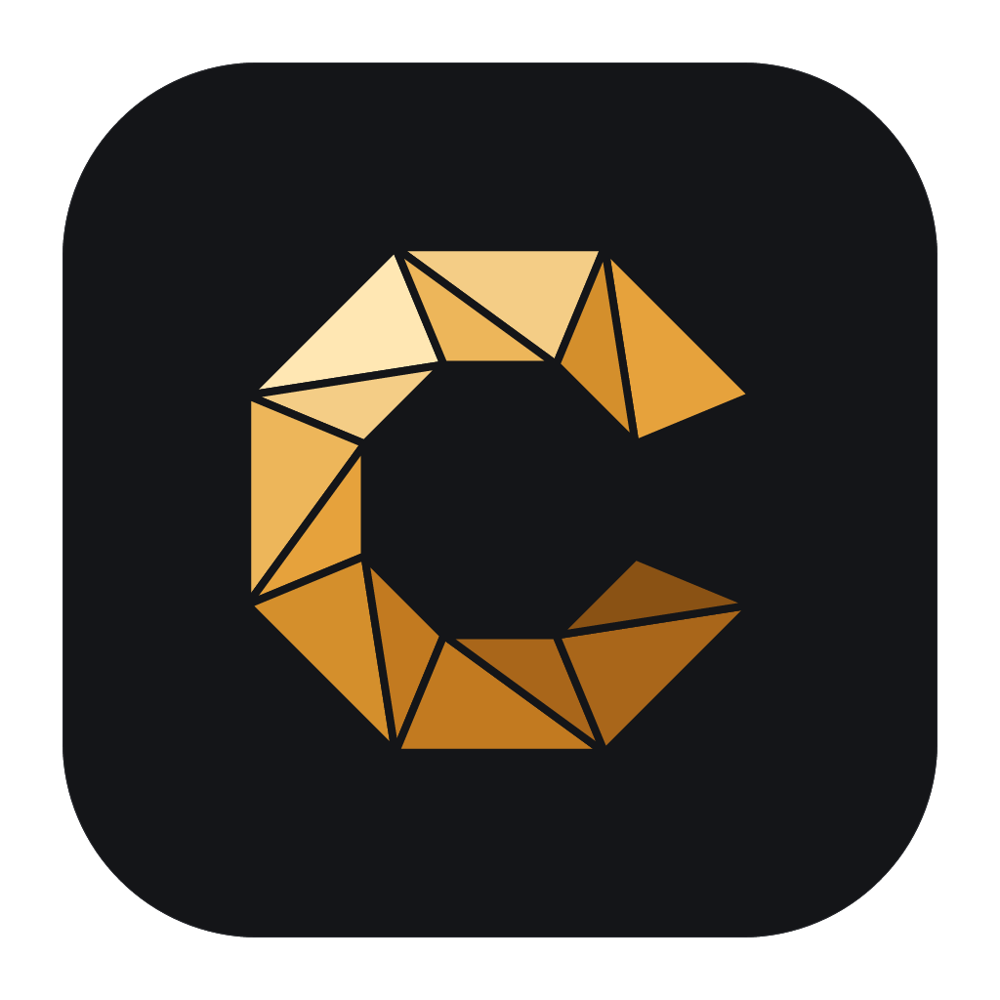
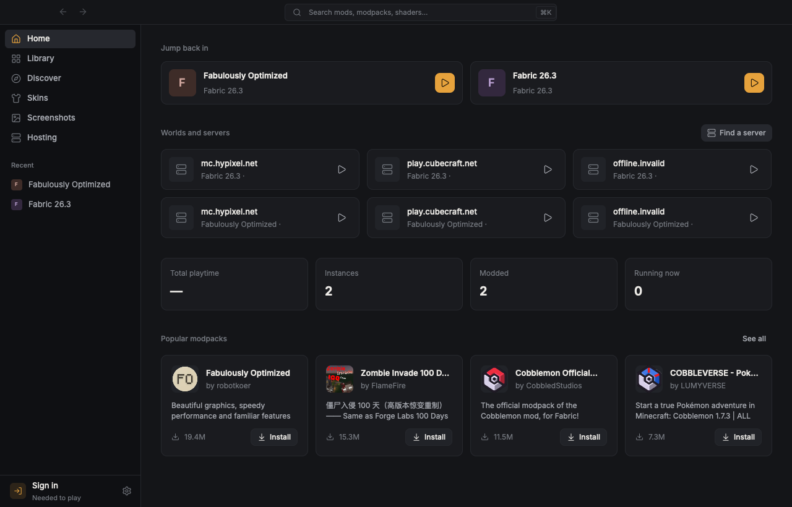
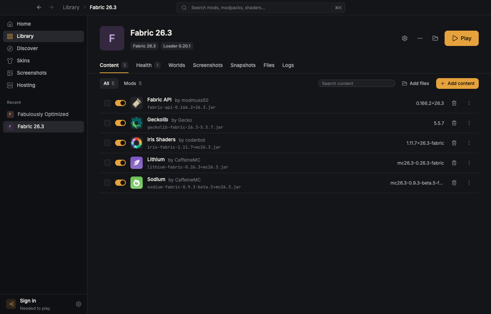
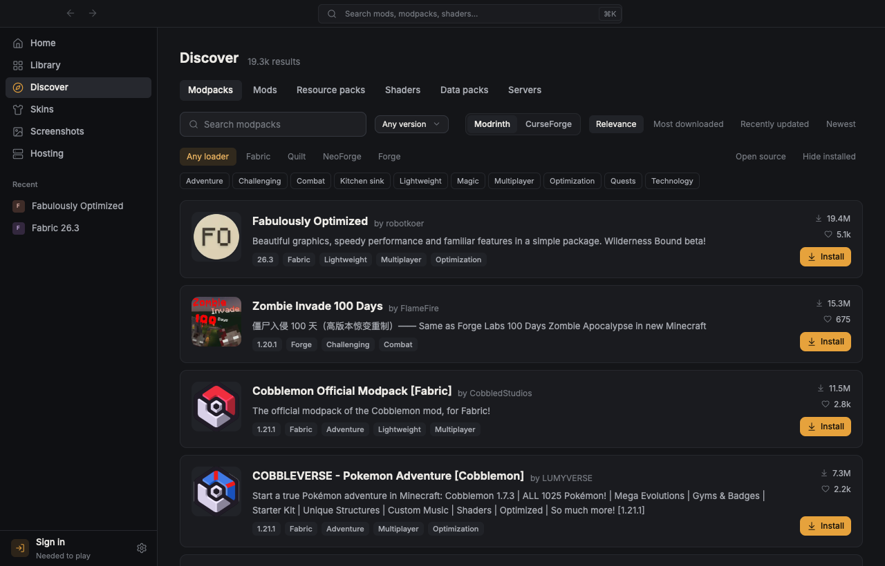
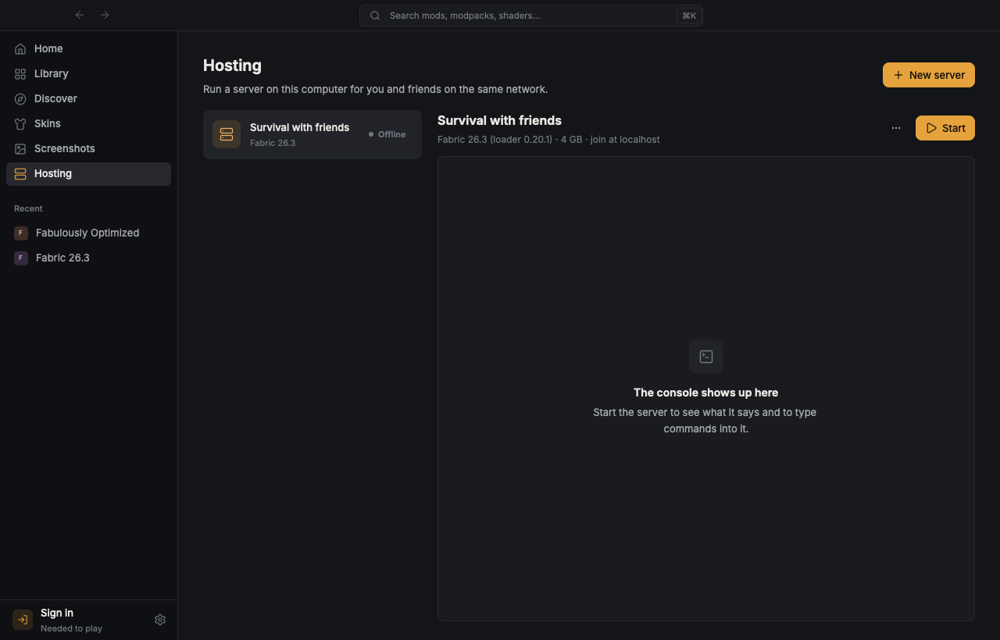
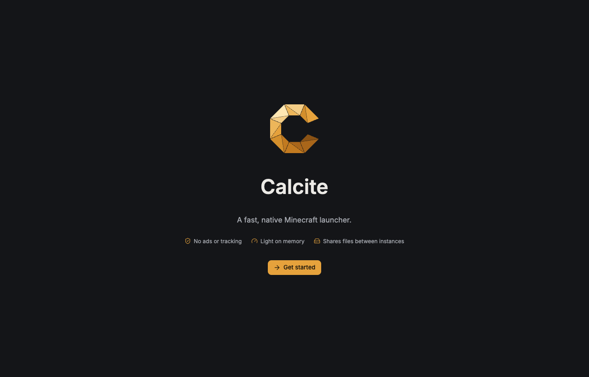

<p align="center">
  
</p>

<h1 align="center">Calcite</h1>

<p align="center">
  A Minecraft launcher for macOS, Windows and Linux.<br>
  Native, quick to open, and light on memory.
</p>

<p align="center">
  <a href="https://github.com/ByteV0rtex/calcite/releases/latest">Download</a>
  ·
  <a href="#building">Build it yourself</a>
</p>

<p align="center">
  
</p>

I wanted something that does everything Modrinth App does without being a
web page in a window. Calcite is written in Rust with
[GPUI](https://www.gpui.rs), and uses Modrinth's own open-source launcher
backend for the parts that have to be exactly right (installing, launching,
accounts). Sitting idle it uses around 60 MB of memory and no CPU.

## What it does

- Instances with Fabric, Quilt, Forge or NeoForge, and Modrinth modpacks.
- Mods, resource packs, shaders and data packs from **Modrinth** and
  **CurseForge**, including CurseForge modpacks.
- Microsoft accounts, Java handled for you, skins and capes with a 3D
  preview, and Modrinth friends.
- A health check for each instance, a crash explainer, and a "find the
  broken mod" helper that narrows it down by halves.
- Snapshots of an instance you can roll back to, and world backups when
  the game closes.
- A server browser, and **hosting your own server** (Vanilla, Fabric or
  Paper) with a live console.
- Moving in from Modrinth App, Prism, MultiMC, ATLauncher, GDLauncher, the
  CurseForge app, the official launcher, Lunar and Dawn (Feather).
- A command palette (⌘K / Ctrl+K), drag and drop for mods, packs and
  worlds, and a storage page that shows where your disk space went.

No ads, nothing to buy, no telemetry.

<p align="center">
  
  
</p>
<p align="center">
  
  
</p>

## Installing

Grab the file for your system from the
[latest release](https://github.com/ByteV0rtex/calcite/releases/latest):

| System | File |
|---|---|
| macOS (Apple silicon) | `Calcite-…-macos-arm64.dmg` |
| Windows | `Calcite-…-windows-x64-setup.exe`, or the portable `.zip` |
| Linux | `calcite_…_amd64.deb`, or the `.AppImage` |

The builds aren't signed yet, so the first launch needs one extra step:

- **macOS:** right-click Calcite in Applications and choose **Open**.
- **Windows:** if SmartScreen stops it, click **More info**, then **Run anyway**.

The portable Windows build keeps everything in a `data` folder next to
`calcite.exe`. Delete `portable.txt` if you'd rather it use the normal
folder.

Already using another launcher? Calcite offers to bring your instances,
accounts and worlds over the first time it opens, and leaves the originals
alone.

## Building

You need stable Rust, a JDK (17 or newer, for the backend's build step), and
on macOS the Xcode command line tools.

```bash
scripts/sync-backend.sh          # fetch and patch the launcher backend
cargo run -p calcite             # debug build, uses a separate CalciteDev folder
cargo build --release -p calcite -p calcite-login
```

To make the installers (they end up in `dist/`):

```bash
scripts/package-macos.sh         # Calcite.app and a .dmg
scripts/package-linux.sh         # .deb, plus an AppImage if appimagetool is around
scripts/package-windows.ps1      # setup.exe (Inno Setup) and a portable .zip
```

CurseForge needs an API key at build time. Put yours in `.curseforge-key`
(it's git-ignored) or set `CALCITE_CURSEFORGE_KEY`. Without one, Calcite
just doesn't show CurseForge.

Pushing a `v*` tag builds every installer in CI, installs and launches each
one, and attaches them to a draft release.

## How it's put together

```
crates/calcite        the app: pages, theme, image cache, the bridge to the backend
crates/calcite-core   everything that isn't UI: Modrinth and CurseForge clients,
                      health checks, crash reading, snapshots, moving in, servers
crates/calcite-login  the small window Microsoft sign-in opens in
```

Installing, launching and accounts come from `theseus`, the backend of
Modrinth App (GPL-3.0). Calcite pins a version of it and keeps its few
changes in `patches/`. The interface and everything past what Modrinth App
does are Calcite's own.

## License

GPL-3.0-only. Calcite isn't affiliated with Modrinth, Mojang, Microsoft or
CurseForge. Fonts: Inter and JetBrains Mono (SIL OFL). Icons: Lucide (ISC).
